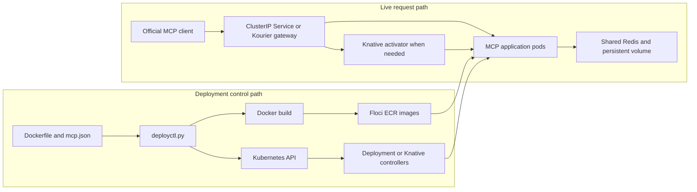

# MCP deployment platform

The developer supplies a compatible project with `Dockerfile` and `mcp.json`.
One CLI validates configuration, builds and publishes an image, updates the
selected runtime, waits for readiness, and reports success or restores the prior
healthy application after a failed update. Project names, tools, entrypoints
and environment settings come from the project.

```powershell
# Always-on: two replicas by default, same pipeline for both examples.
.\.venv\Scripts\python.exe deployctl.py deploy servers/stateless --kubeconfig .local/floci.kubeconfig --namespace mcp-demo --push-registry localhost:4566/000000000000/us-east-1 --version v3
.\.venv\Scripts\python.exe deployctl.py deploy servers/stateful --kubeconfig .local/floci.kubeconfig --namespace mcp-demo --push-registry localhost:4566/000000000000/us-east-1 --version v3

# Optional request-based Knative backend selected by project configuration.
.\.venv\Scripts\python.exe deployctl.py deploy servers/stateless --config mcp.knative.local.json --kubeconfig .local/floci.kubeconfig --namespace mcp-auto --push-registry localhost:4566/000000000000/us-east-1 --version v3
```

Any project satisfying [the deployment contract](DEPLOYMENT_CONTRACT.md) can
replace the example directories. Replace `--push-registry ...` with
`--image REGISTRY/PROJECT@sha256:DIGEST` to reuse a published image. The demo
discovers existing image references and performs no Docker builds or
infrastructure installation.

## Control plane and data plane



Live requests do not invoke Docker or the deployment CLI. Always-on Services
select ready application pods. Knative requests enter Kourier with the service's
Host header and use revision routing and the queue proxy. At zero replicas, the
activator holds requests while the autoscaler starts application capacity.
Ingress stays running.

Builds and controllers still compete with traffic for local CPU, memory and
network capacity. These are independent execution paths on shared hardware.
Full mode measures traffic during independent application deployment, version
promotion, pod deletion and rollback, without retries concealing failures.

## Docker build and Floci ECR publication

The supplied Dockerfile determines image contents. BuildKit provenance is
disabled for repeatable cached image IDs in this evaluation. Tags combine the
supplied release version and full build ID; unrelated image bytes do not
silently replace an existing version. Knative uses a published manifest digest
to avoid controller-side resolution of local registry tags. A Knative release
annotation creates a revision even if cached image bytes are unchanged.

Floci exposes local AWS EKS/ECR APIs. EKS runs in **real mode**, using an actual
Docker-hosted k3s cluster. ECR references use
`localhost:4566/000000000000/us-east-1/PROJECT`; Floci configures the k3s
containerd registry mirror. A host push alone would not verify cluster pulls.

Quick rolls between an available historic stateless image and the Phase 3
image. Full also promotes new Knative revisions of existing published images.
These demonstrate deployment versions; Full does not claim to compile new
application code during the traffic test.

## Container and Kubernetes contract

Both examples use real MCP Python SDK 2.3.0, sessionless Streamable HTTP `/mcp`,
`/health`, and port 8000. Environment variables configure host, port, allowed
hostnames and Redis. Docker runs Python directly as a non-root process and
delivers SIGTERM. Kubernetes permits 30 seconds for graceful termination.

| Resource | Purpose |
| --- | --- |
| Namespace | Separates always-on `mcp-demo` from Knative `mcp-auto` |
| Deployment | Maintains two replicas by default, requests/limits, health probes and rolling updates |
| ClusterIP Service | Stable internal address routing to ready endpoints |
| PodDisruptionBudget | Requests one available replica during voluntary evictions; does not protect against host failure |
| Redis Deployment and Service | Shared data dependency outside MCP replicas |
| PersistentVolumeClaim | Stores Redis AOF independently of application pods |

Startup probes allow warm-up, readiness controls endpoints and liveness
restarts an unhealthy process. Sample `/health` reports process health, not
Redis or downstream dependency health.

## Stateless execution and shared Redis state

`echo` returns its message; `add_numbers` returns its sum. Either stateless
replica can answer any request. `increment_counter` uses Redis atomic `INCRBY`;
`get_counter` uses Redis `GET`. Separate connections and different pods see the
same key. No application counter lives in Python memory. Both examples use a
sessionless MCP transport; application state and transport sessions are distinct.

The bounded asynchronous `delay_seconds` argument on echo/increment supports
sustained real MCP concurrency tests. Counter mutation still happens in Redis.
Compose, always-on Kubernetes and Knative have separate Redis instances, so
checks use unique keys within each environment rather than assume shared data
between namespaces.

Local Redis has one replica and AOF on a local-path PVC backed by the existing
k3s Docker volume. MCP pod survival tests do not prove Redis failover, backup
restoration or Docker-host-loss durability.

## Knative autoscaling and scale-to-zero

`autoscaling.enabled` selects Knative through the same CLI. Knative owns its
generated Deployments, Services, Revisions and replica counts. The CLI does not
manually scale those Deployments.

| Project field | Knative revision annotation |
| --- | --- |
| `minReplicas` | `autoscaling.knative.dev/min-scale` |
| `activationReplicas` | `autoscaling.knative.dev/activation-scale` and `initial-scale` (at least minimum) |
| `maxReplicas` | `autoscaling.knative.dev/max-scale` |
| `targetConcurrency` | `autoscaling.knative.dev/target`, KPA concurrency metric |
| `windowSeconds` | `autoscaling.knative.dev/window` |

Profiles use min 0, activation 2, target concurrency 2 and a 20-second window.
`mcp.knative.json` permits max 10; `mcp.knative.local.json` caps 4 for concurrent
local tests. Concurrency is a soft scaling target, not an RPS limit or a promise
that all desired replicas fit the host.

Serving/Kourier are pinned at 1.23.0 on Kubernetes 1.34.1+k3s1. Controllers,
autoscaler, activator, webhook, gateway and Redis remain up at zero application
replicas. Local infrastructure HPAs are bounded to one replica for this host.

Local routes are `http://NAME.mcp-auto.mcp.test/mcp`; public DNS/TLS is absent.
Tests forward the **Kourier Service**, set the route Host header, and invoke
actual MCP tools. They do not bypass the ingress to wake a zero-scale pod.
Measured cold latency includes scheduling, startup, probes and MCP negotiation.

## Rolling updates and recovery

Always-on updates use `maxUnavailable: 0`, `maxSurge: 1`, readiness and minimum
readiness time. The CLI waits for the healthy requested replica count. Failure
restores the prior Deployment, Service and PDB and waits with an independent
recovery timeout. Failed first deployments retain dependency data.

Knative retains 100% traffic on the healthy prior revision while starting a
candidate. Template matching avoids selecting a stale status revision.
Promotion waits for actual route status. Failure restores configuration and
the old route and removes the failed unrouted candidate. The failed deployment
still exits nonzero when rollback succeeds.

After rollback, latest-created/latest-ready metadata can differ from the
revision pinned in traffic. The route determines what clients receive. This
single-operator synchronous CLI has no distributed lock, deployment API or job
queue. Long-lived streams and arbitrary application drain behavior need further
testing. Two replicas alone do not establish zero downtime.

## Future multi-region architecture (not implemented)

Use separate clusters/ingress per region with global routing, regional capacity
limits, replicated images and a coordinator tracking regional desired versions.
Failover must respect identity and data locality. Redis writes require explicit
consistency/conflict handling, RPO/RTO, backups and regional failure drills.
Atomic local counters do not establish cross-region consistency. No multi-region
resources or routing were implemented.

## Future self-hosting approach (not implemented)

Keep Dockerfile/mcp.json and the Kubernetes/Knative backend. Supply another
registry, storage class, ingress, DNS/TLS and credentials. Operate redundant
control/worker nodes and Redis, then validate upgrades, capacity, backups and
authentication. Explicit kubeconfigs already select a cluster without changing
the user's context. Application portability does not eliminate infrastructure
operations work.

## Current limitations

One Docker host and one k3s node share a failure domain. Runtime quota is four
CPUs; scheduler allocatable CPU remains 1930m. Local single-replica Redis and
storage are not redundant. Production multi-AZ HA has not been verified. No
1,000-server capacity test was run. Scaling applications to zero does not turn
off workers or platform services.

Production work includes MCP/deployment authentication, TLS, secret references,
tenant isolation, quotas, telemetry/audit, registry credential lifecycle,
supply-chain controls, redundant Redis/backups, concurrent operator safety,
worker capacity management and failure tests on real AWS. See
[cost assumptions](COST_COMPARISON.md) and [executed demo results](FINAL_DEMO_REPORT.md).
